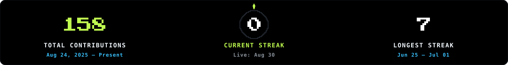
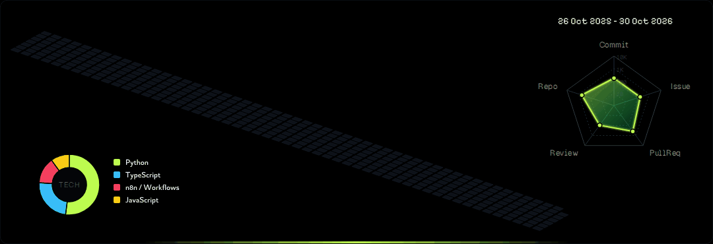

<!-- Typing Subtitle Animation -->

  

<!-- Hero ASCII Profile Animation -->

  <picture>
    <source media="(prefers-reduced-motion: reduce)" srcset="./assets/profile-hero-static.svg" />
    
  </picture>

<!-- Section 2: GitHub Analytics -->

<picture>
  <source media="(prefers-reduced-motion: reduce)" srcset="./profile-3d-contrib/profile-night-green.svg" />
  <source type="image/apng" srcset="./profile-3d-contrib/profile-night-green.png" />
  
</picture>

<!-- Section 3: Tech Stack -->
<picture>
  <source media="(max-width: 600px) and (prefers-reduced-motion: reduce)" srcset="./assets/readme-panels/tech-stack-mobile-static.svg" />
  <source media="(prefers-reduced-motion: reduce)" srcset="./assets/readme-panels/tech-stack-static.svg" />
  <source media="(max-width: 600px)" srcset="./assets/readme-panels/tech-stack-mobile.svg" />
  
</picture>

<!-- Section 4: Connect & Collaborate -->

  
  &nbsp;
  
  &nbsp;
  
  &nbsp;
  
  &nbsp;
  

